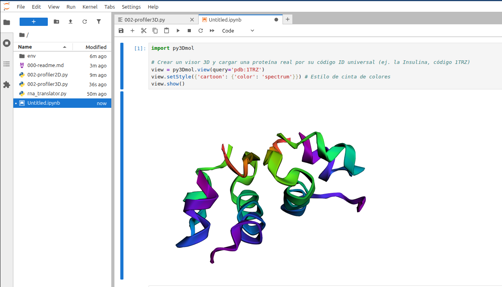

### instalar lo siguiente

```bash
# NOTA py3dmol no funciona en python mayor de 3.11 de momento

# 1. Crear el entorno conda apuntando a una carpeta local en tu proyecto
conda create --prefix ./env python=3.11 -y

# 2. Activar el entorno usando la ruta local
conda activate ./env

# 3. Instalar tus paquetes dentro de tu entorno conda local
conda install -c conda-forge py3dmol biopython matplotlib numpy -y

./env/bin/pip install --force-reinstall py3dmol
```


